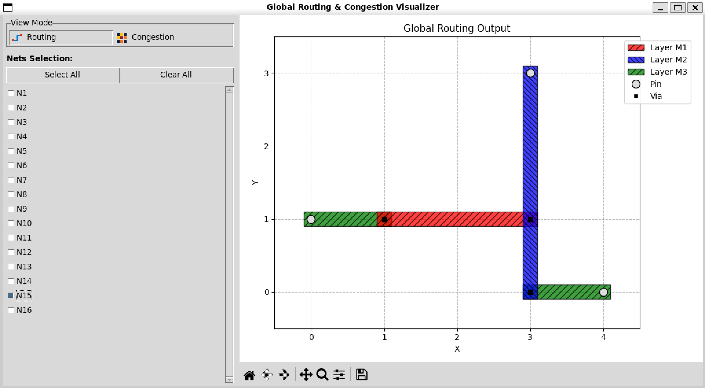
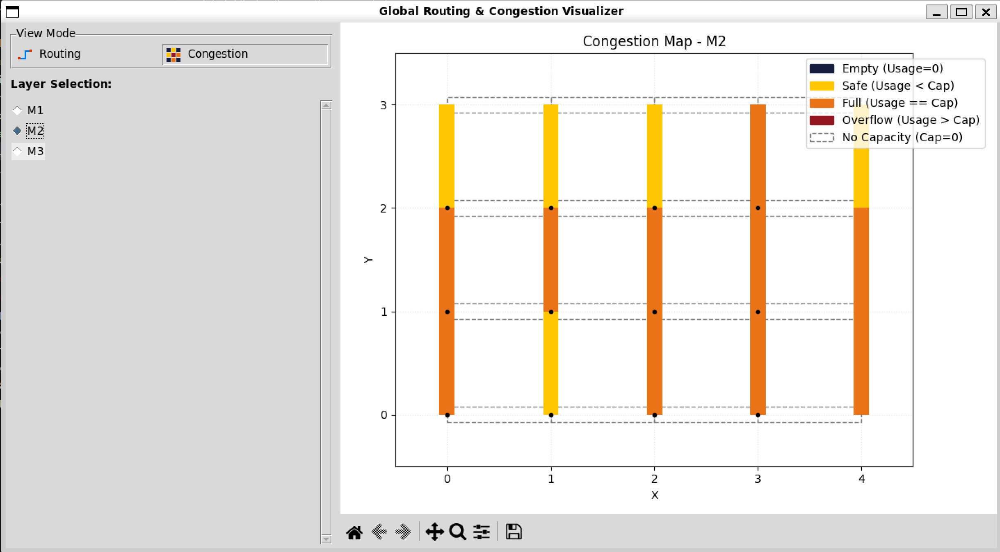

# Simple Global Router

This project is a C++ global router for project3 of Design Automation course. The flow is:

1. Parse the routing benchmark
2. Generate an initial routing solution with FLUTE
3. Apply rip-up and reroute to reduce overflow
4. Layer assignment
5. Write the final routing result to output file

The current implementation focuses on a clean end-to-end routing flow and uses a history-based cost during rerouting.

## Project Structure

```text
.
├── include/
│   ├── Structure.hpp
│   └── Timer/
├── src/
│   ├── main.cpp
│   ├── Parser/
│   ├── Router/
│   └── OutputWriter/
├── scripts/
│   └── visualizer.py
├── docs/
├── testcase/
├── output/
├── third_party/
│   └── flute/
└── CMakeLists.txt
```

Important files:

- `src/main.cpp`: program entry point
- `src/Parser/Parser.cpp`: input parsing and routing database construction
- `src/Router/FluteRouter.cpp`: initial routing based on FLUTE
- `src/Router/Router.cpp`: rip-up and reroute
- `src/OutputWriter/OutputWriter.cpp`: final output writer
- `include/Structure.hpp`: core data structures

## Requirements

- CMake >= 3.10
- A C++11 compiler
- `make`

This project also includes the FLUTE source and lookup tables under `third_party/flute/`, so no extra external installation is needed.

## Build

Recommended out-of-source build:

```bash
mkdir -p build
cd build
cmake ..
make
```

If you modify only `.cpp` files:

```bash
cd build
make
```

If you modify `CMakeLists.txt`:

```bash
cd build
cmake ..
make
```

If you want a clean rebuild:

```bash
rm -rf build
mkdir build
cd build
cmake ..
make
```

After building, the executable will be:

```bash
cd build
./main
```

## Run

Usage:

```bash
cd build
./main <input txt file> <output txt file> [-c <congestion_map.txt>]
```

Example:

```bash
./main ../testcase/proj_3_global_routing_inputs_v2.txt ../output/proj_3_global_routing_outputs.txt

# or adding congestion map using '-c'
./main ../testcase/proj_3_global_routing_inputs_v2.txt ../output/proj_3_global_routing_outputs.txt -c ../output/congestion_map.txt
```

The program prints progress messages and a timer report for:

- Parse
- Route
- Output
- Total runtime

Notes:

- Run the executable from the `build/` directory so the FLUTE lookup tables can be found correctly.
- `-c <congestion_map.txt>` is optional. When provided, the router writes an extra congestion map file for later visualization.

## Visualization

A Python visualizer is provided in `scripts/visualizer.py` to inspect the routing results and congestion maps.

```bash
# Run the visualizer with the input file, routing output, and the optional congestion map
python scripts/visualizer.py testcase/proj_3_global_routing_inputs_v2.txt output/proj_3_global_routing_outputs.txt -c output/congestion_map.txt
```

### Routing View
Displays the detailed routing path of each net on different layers.


### Congestion Map View
Provides a heatmap representation of edge capacity usage.


## Input Format

The parser currently supports the following sections:

- `routing_layers`
- `Gcell_grid`
- `Gcell ...`
- `nets ...`

Example:

```text
routing_layers 3 M1 horizontal M2 vertical M3 horizontal
Gcell_grid 5 4
Gcell
...
end_of_Gcell
nets
...
end_of_nets
```


## Output Format

The output file begins with the grid information:

```text
Gcell_grid  5 4
```

After that, each net is written on one line using its routed traversal order:

```text
N1 (0,0), (1,0), (2,0), (2,1)
```

If `-c` is specified, the program also writes a plain-text congestion map. The file starts with comments describing the format, followed by grid size, layer definitions, and one record per unit edge on each layer:

```text
# GRID <cols> <rows>
# LAYER <layer_name> <preferred_direction>
# EDGE <layer_name> <orientation:H|V> <x1> <y1> <x2> <y2> <capacity> <usage>

GRID 5 4
LAYER M1 horizontal
LAYER M2 vertical
LAYER M3 horizontal

EDGE M1 H 0 0 1 0 1 0
EDGE M1 H 0 1 1 1 1 1
EDGE M2 V 0 0 0 1 3 3
```


## Data Structures

The main data structures are defined in `include/Structure.hpp`.

### `RoutingDB`

Stores the whole routing database:

- grid size: `cols`, `rows`
- routing layers and preferred directions
- horizontal edges: `hEdges`
- vertical edges: `vEdges`
- all nets

### `Edge`

Each edge stores:

- `capacity`: available routing capacity
- `usage`: current number of nets using this edge
- `historyCost`: accumulated congestion history used in rerouting
- `initialized`: whether the capacity was assigned
- `netIds`: `std::unordered_set<int>` of nets currently using the edge
- `layerCapacity`: capacity of this edge on each routing layer
- `layerUsage`: usage of this edge on each routing layer

### `Net`

Each net stores:

- net id and name
- all pins
- `routedPaths`: routed branch paths
- `orderedPoints`: final traversal order written to the output

## Routing Flow

### 1. Parsing

`parseInputFile()` builds a `RoutingDB` from the benchmark file.

The `Gcell` section is converted into edge capacities by collapsing layer capacities according to preferred routing directions:

- left/right capacities contribute to horizontal edges
- bottom/top capacities contribute to vertical edges

### 2. Initial Routing with FLUTE

`routeAllNetsByFlute()` performs initial routing for every net.

For each net:

1. The pins are passed to FLUTE to generate a rectilinear Steiner tree.
2. Each FLUTE branch is converted into one routed path.
3. A best L-shape is chosen for each branch by comparing:
   - horizontal then vertical
   - vertical then horizontal
4. The selected path updates edge usage and edge-to-net membership.

The initial routing cost favors lower congestion through a sigmoid-like penalty:

- edges over capacity become much more expensive
- zero-capacity edges are treated as unavailable

### 3. Rip-up and Reroute

`RipupAndReroute()` is used after FLUTE routing to reduce overflow.

The current implementation works as follows:

1. Find all overflow edges
2. Increase `historyCost` on every overflow edge
3. Try to reroute one branch that uses an overflow edge
4. Recompute overflow and repeat for a limited number of iterations

Important details:

- A branch candidate is selected from the nets using a target overflow edge.
- Candidate selection is randomized from all paths that actually use that edge.
- The selected old path is removed from the routing tree.
- The remaining net is split into two connected components.
- A multi-source multi-sink Dijkstra search reconnects the two components.
- If no legal replacement path is found, the old path is restored.

### Reroute Cost Function

During rerouting, the edge cost is based on:

- current edge usage
- edge capacity
- history cost

This gives congested edges a growing penalty over time, encouraging later iterations to avoid repeatedly overflowing the same area.


## Example Workflow

```bash
mkdir -p build
cd build
cmake ..
make
./main ../testcase/proj_3_global_routing_inputs_v2.txt ../output/proj_3_global_routing_outputs.txt

# or adding congestion map using '-c'
./main ../testcase/proj_3_global_routing_inputs_v2.txt ../output/proj_3_global_routing_outputs_v2.txt -c ../output/congestion_map.txt
```
